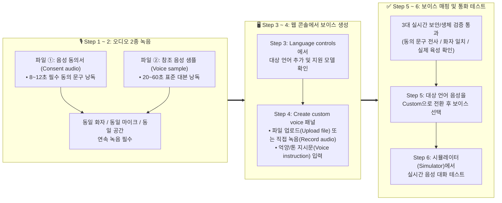
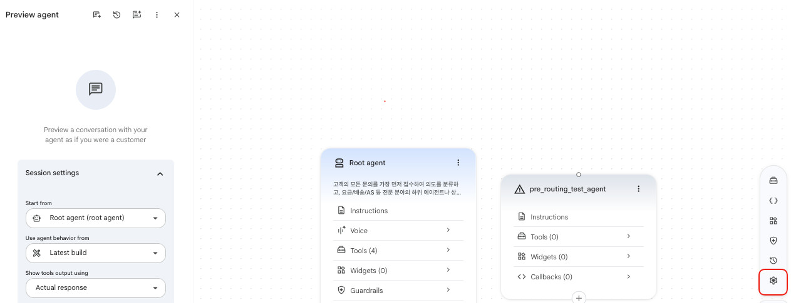
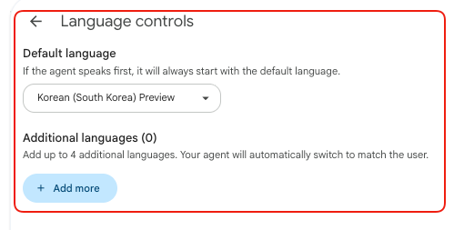
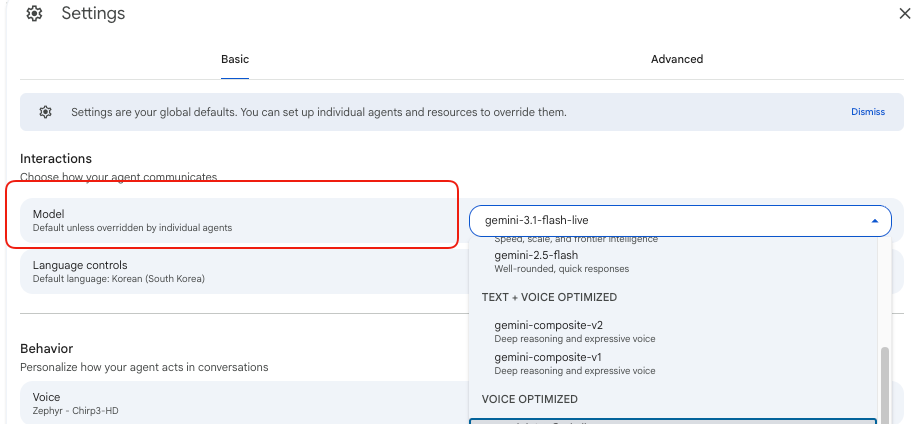

# Google Cloud CX Agent Studio (CXAS) — Custom Voice 생성 및 온보딩 단계별 가이드

> **문서 개요**: 본 가이드는 **Google Cloud Gemini Enterprise for Customer Experience** 환경에서 실제 성우 또는 대표 상담원의 목소리를 녹음하여 **브랜드 전용 커스텀 보이스(Custom Voice)** 를 셀프서비스로 생성하고 에이전트에 적용하는 **단계별(Step-by-Step) 실무 가이드**입니다.
>
> **Custom Voice UI 공식 GA 출시 (2026년 10월 28일)** 에 따라, 별도의 프로젝트 허용 목록(Allowlist) 승인 대기 없이 담당자가 직접 웹 콘솔(UI)에서 **오디오 파일 2종(동의서 + 음성 샘플)** 을 업로드하거나 브라우저 마이크로 녹음하여 즉시 모든 아키텍처에 적용할 수 있습니다.

---

## 📑 목차 (Table of Contents)

1. [Custom Voice 온보딩 전체 흐름 한눈에 보기](#1-custom-voice-온보딩-전체-흐름-한눈에-보기)
2. [Step 1: 사전 준비 — 필수 오디오 2종 규격 및 3대 자동 검증 기준 이해하기](#2-step-1-사전-준비--필수-오디오-2종-규격-및-3대-자동-검증-기준-이해하기)
   - [1.1. 제출해야 하는 오디오 파일 2종 요약](#11-제출해야-하는-오디오-파일-2종-요약)
   - [1.2. 저장 시 수행되는 3대 실시간 생체·보안 검증 기준](#12-저장-시-수행되는-3대-실시간-생체보안-검증-기준)
3. [Step 2: 오디오 2종 녹음하기 (동의서 문구 + 표준 샘플 대본)](#3-step-2-오디오-2종-녹음하기-동의서-문구--표준-샘플-대본)
   - [2.1. 파일 ①: 음성 동의서 (`Consent audio` — 8~12초 필수 낭독 문구)](#21-파일--음성-동의서-consent-audio--812초-필수-낭독-문구)
   - [2.2. 파일 ②: 참조 음성 샘플 (`Voice sample` — 20~60초 표준 대본 3선)](#22-파일--참조-음성-샘플-voice-sample--2060초-표준-대본-3선)
   - [2.3. 고품질 음성 복제를 위한 녹음 환경·마이크 세팅 및 5단계 체크리스트](#23-고품질-음성-복제를-위한-녹음-환경마이크-세팅-및-5단계-체크리스트)
4. [Step 3: CX Agent Studio 웹 콘솔에서 대상 언어 및 지원 모델 설정하기](#4-step-3-cx-agent-studio-웹-콘솔에서-대상-언어-및-지원-모델-설정하기)
5. [Step 4: `Create custom voice` 화면에서 Custom Voice 생성하기](#5-step-4-create-custom-voice-화면에서-custom-voice-생성하기)
   - [4.1. `Create custom voice` 패널 열기 및 보이스 이름 지정](#41-create-custom-voice-패널-열기-및-보이스-이름-지정)
   - [4.2. 오디오 2종 등록 (`Upload file` 파일 업로드 vs. `Record audio` 브라우저 녹음)](#42-오디오-2종-등록-upload-file-파일-업로드-vs-record-audio-브라우저-녹음)
   - [4.3. 억양 및 발화 스타일 지시문(`Voice instruction`) 설정하기](#43-억양-및-발화-스타일-지시문voice-instruction-설정하기)
   - [4.4. 산업별·상황별 `Voice instruction` 프롬프트 템플릿](#44-산업별상황별-voice-instruction-프롬프트-템플릿)
   - [4.5. 생성 완료(`Create` / `Save`) 및 미리듣기(Preview) 확인](#45-생성-완료create--save-및-미리듣기preview-확인)
6. [Step 5: 대상 언어에 Custom Voice 매핑 및 통화 행동 최적화하기](#6-step-5-대상-언어에-custom-voice-매핑-및-통화-행동-최적화하기)
   - [5.1. 대상 언어에 생성한 Custom Voice 연결하기](#51-대상-언어에-생성한-custom-voice-연결하기)
   - [5.2. 발화 속도(Tempo), 배경 효과음, 끼어들기(Barge-in), 묵음 대기 설정](#52-발화-속도tempo-배경-효과음-끼어들기barge-in-묵음-대기-설정)
7. [Step 6: 시뮬레이터(Simulator) 실시간 음성 테스트 및 검증](#7-step-6-시뮬레이터simulator-실시간-음성-테스트-및-검증)
8. [부록 A: CES v1 REST API를 활용한 Custom Voice 자동화 및 운영 주의사항](#8-부록-a-ces-v1-rest-api를-활용한-custom-voice-자동화-및-운영-주의사항)
   - [A.1. 아키텍처별 내부 동작 및 5일 주기 자동 갱신(Re-mint) 주의사항](#a1-아키텍처별-내부-동작-및-5일-주기-자동-갱신re-mint-주의사항)
   - [A.2. Cloud Storage(GCS) 권한 부여 및 REST API (`GET` / `PATCH`) 예제](#a2-cloud-storagegcs-권한-부여-및-rest-api-get--patch-예제)
9. [부록 B: 자주 묻는 질문 및 에러 해결 가이드 (Troubleshooting & FAQ)](#9-부록-b-자주-묻는-질문-및-에러-해결-가이드-troubleshooting--faq)

---

## 1. Custom Voice 온보딩 전체 흐름 한눈에 보기

**CX Agent Studio Custom Voice (셀프서비스 UI)** 는 실제 성우나 상담원이 녹음한 **① 동의서 오디오(8~12초)** 와 **② 참조 음성 샘플(20~60초)** 두 개의 파일만으로 브랜드 고유의 AI 상담원 목소리를 즉시 생성하고 원하는 언어(한국어, 영어, 일본어 등 30개 이상의 다국어 로케일)에 적용하는 기능입니다.


---

## 2. Step 1: 사전 준비 — 필수 오디오 2종 규격 및 3대 자동 검증 기준 이해하기

### 1.1. 제출해야 하는 오디오 파일 2종 요약

커스텀 보이스 1개를 생성하려면 **동일한 화자(성우/상담원)가 한 자리에서 연속으로 녹음한 2개의 오디오 파일**이 필요합니다.

| 구분 | 콘솔 UI 항목명 | 권장 녹음 길이 | 지원 파일 포맷 및 상세 규격 |
| :--- | :--- | :--- | :--- |
| **파일 ①** | **`Consent audio`**<br/>(음성 동의서) | **8 ~ 12초** | • **지원 포맷**: `WAV` (강력 권장), `MP3`, `M4A`, `OGG`, `FLAC`<br/>• **파일 크기 제한**: 파일당 최대 **10 MB** 이하<br/>• **권장 녹음 규격**: 무손실 PCM `WAV` (24 kHz 또는 48 kHz, 16-bit / 24-bit, Mono) |
| **파일 ②** | **`Voice sample`**<br/>(참조 음성 샘플) | **20 ~ 60초**<br/>*(최적 구간: **30 ~ 40초**)* | • 서버 업로드 시 내부 FFmpeg 파이프라인이 모든 지원 오디오 포맷을 자동으로 **24 kHz / 16-bit / Mono 표준 WAV**로 변환하여 처리합니다.<br/>• **묵음(Silence) 비율 제한**: 전체 녹음 길이 중 말이 없는 무음 구간이 **20% 미만**이어야 합니다. |

---

### 1.2. 저장 시 수행되는 3대 실시간 생체·보안 검증 기준

본인 동의 없는 타인 목소리 복제 및 딥페이크 악용을 방지하기 위해, 콘솔에서 **`Create` / `Save`** 버튼을 누르면 백엔드에서 아래 **3가지 보안 검증**을 실시간으로 수행합니다.

| 검증 항목 | 검증 원리 및 통과 기준 | 업로드가 거부되는 주요 원인 |
| :--- | :--- | :--- |
| **① 동의 문구 전사 일치 검증**<br/>*(ASR Transcript Match)* | `Consent audio`(파일 ①)를 STT로 텍스트 변환하여 공식 동의 문구와 일치하는지 대조합니다.<br/>• **통과 기준**: **단어 오류율(WER) 15% 미만** | • 지정된 동의 문구의 조사나 단어를 임의로 바꾸거나 생략한 경우<br/>• 문구 앞뒤에 `"안녕하세요"`, `"녹음 시작하겠습니다"` 같은 불필요한 멘트를 추가한 경우 |
| **② 화자 신원 일치 검증**<br/>*(Speaker Identity Match)* | 음향 임베딩(Acoustic embedding) 모델이 **파일 ①(동의서)의 화자**와 **파일 ②(음성 샘플)의 화자**가 동일 인물인지 성문 유사도를 검증합니다. | • 성우 본인이 아닌 다른 사람이 동의서를 대독한 경우<br/>• **같은 화자라도 서로 다른 날, 다른 방, 다른 마이크(예: 휴대폰 vs 스튜디오 마이크)로 따로 녹음하여 음향 특성이 달라진 경우** |
| **③ 실제 육성 확인 검증**<br/>*(DeepMind SynthID / SSD)* | 업로드된 오디오가 AI 합성 음성이 아닌 **실제 사람의 육성(Live human speaker)** 인지 판별합니다. | • 외부 TTS나 AI로 생성한 합성 음성을 업로드한 경우<br/>• 오디오 편집 프로그램에서 과도한 노이즈 제거 필터나 피치 변조 이펙트를 적용해 원음이 왜곡된 경우 |

> [!CAUTION]
> **🚨 필수 주의사항: 두 파일(파일 ① & 파일 ②)은 반드시 한 자리에서 연속 녹음하세요!**
> 동의서 파일(`Consent audio`)과 샘플 파일(`Voice sample`)의 마이크, 공간 울림, 마이크 거리가 서로 다르면 동일 인물이더라도 화자 검증 알고리즘이 불일치로 판단하여 다음 에러와 함께 생성을 차단합니다:
> `APP_ERROR: Voice mismatch detected. The speaker in the consent audio does not match the speaker in the voice sample.`

---

## 3. Step 2: 오디오 2종 녹음하기 (동의서 문구 + 표준 샘플 대본)

### 2.1. 파일 ①: 음성 동의서 (`Consent audio` — 8~12초 필수 낭독 문구)

조용한 환경에서 차분하고 또렷한 발음으로 아래 문장을 **토씨 하나 틀리지 않고 그대로(Word-for-Word)** 소리 내어 읽고 첫 번째 파일(`speaker_01_consent.wav`)로 저장하세요. 앞뒤에 다른 인사말을 넣지 말고 아래 문장만 읽어야 합니다.

#### 📌 공식 음성 동의 문구 (Gemini TTS / Voices API 기준)
```text
"저는 이 음성의 소유자이며, Google Cloud를 사용하여 제 음성의 합성 모델을 생성하는데 동의했습니다."
```


<details>
<summary>💡 <b>(참고) 영문 또는 Chirp 3 모델용 공식 동의 문구 보기</b></summary>

성우가 마이크 앞에 앉았을 때 아래 문장(각 10초 내외)도 같은 자리에서 함께 녹음해 두시면, 다국어 에이전트 구성이나 세부 TTS 모델(`Chirp3-HD` 등) 변경 시 성우 재섭외 없이 즉시 활용할 수 있습니다:

1. **영문(`en-US`) 공식 동의 문구 (`speaker_01_consent_en.wav`)**:
   ```text
   "I am the owner of this voice and have consented to the creation of a synthetic model of my voice through the use of Google Cloud."
   ```
2. **Chirp 3: Instant Custom Voice 공식 동의 문구 (`speaker_01_consent_chirp.wav`)**:
   ```text
   "나는 이 음성의 소유자이며 구글이 이 음성을 사용하여 음성 합성 모델을 생성할 것을 허용합니다."
   ```
3. **기타 30개 이상 다국어 공식 동의 문구**: 일본어(`ja-JP`), 스페인어(`es-ES`), 프랑스어(`fr-FR`), 독일어(`de-DE`) 등 전체 언어별 공식 동의 문구는 [Gemini Enterprise Agent Platform — Replicate voices 공식 문서](https://docs.cloud.google.com/gemini-enterprise-agent-platform/models/text-to-speech/voice-replication#consent-statements)에서 확인하실 수 있습니다.
</details>

---

### 2.2. 파일 ②: 참조 음성 샘플 (`Voice sample` — 20~60초 표준 대본 3선)

AI 모델이 화자의 성문 프로필을 가장 풍부하고 자연스럽게 학습할 수 있도록 평음·경음·격음 파열음, 마찰음, 파찰음, 비음·유음 연음, 이중모음, 숫자 발음, 그리고 친절한 종결 어미 억양을 균형 있게 배치한 **표준 스크립트 3선**입니다.

동의서 녹음 직후, **같은 자리·같은 마이크 그대로** 아래 **Option A, B, C 중 브랜드 성격에 맞는 대본 1개를 선택하여 약 35~40초 분량**으로 낭독하고 두 번째 파일(`speaker_02_sample.wav`)로 저장하세요.

---

#### 🎙️ 표준 대본 Option A: 일반 고객 상담 및 멤버십 안내 (가장 범용적인 고객센터용)
```text
"안녕하세요, 고객님! 구글 클라우드의 맞춤형 음성 기술로 구현된 인공지능 전담 상담원입니다. 매월 청구되는 요금 내역을 확인하시거나, 프리미엄 멤버십 혜택으로 변경하시는 것은 물론, 갑작스러운 서비스 이용 불편을 해결하실 때까지 제가 곁에서 빠르고 편리하게 도와드리겠습니다. 저희 고객센터는 매시간 삼백육십 건이 넘는 다양한 문의를 처리하고 있지만, 지금 이 순간 저의 가장 중요한 목표는 고객님께 정확하고 신뢰할 수 있는 답변을 드리는 것입니다. 오늘 어떤 업무를 먼저 도와드릴까요?"
```
- **글자 수 / 예상 시간**: 68 어절 (공백 포함 267자) / 자연스러운 상담 속도 기준 **약 35 ~ 40초**
- **핵심 음운 학습 포인트**:
   - 비음·유음 연음(`구글 클라우드`, `청구되는`, `삼백육십[삼뱅뉵씹]`), 경음·격음(`청구`, `빠르고`, `께`), 이중모음(`요금`, `내역`, `혜택`, `문의`), 친절한 의문형 끝올림 억양(`~도와드릴까요?`)

---

#### 🎙️ 표준 대본 Option B: 기술 지원 및 서비스 장애 트러블슈팅 (IT·통신·가전 고객지원용)
```text
"고객지원센터에 전화해 주셔서 감사합니다. 고객님의 전담 인공지능 음성 어시스턴트로서, 본인 인증 확인부터 결제 수단 변경, 그리고 플랫폼 전반의 정밀 진단 도구 연결까지 지체 없이 바로 안내해 드리겠습니다. 현재 저희 자동화 시스템은 일 분당 칠십오 건 이상의 복잡한 기술 문의를 실시간으로 분석하여 대기 시간 없는 쾌적한 해결책을 제공하고 있습니다. 지금 바로 고객님의 프로필을 살펴보고 사십이 번 접수 티켓의 처리 상태를 확인하여 모든 서비스가 정상 작동하도록 조치해 드리겠습니다. 어떤 항목부터 먼저 점검해 볼까요?"
```
- **글자 수 / 예상 시간**: 71 어절 (공백 포함 282자) / 차분한 기술 상담 속도 기준 **약 35 ~ 40초**
- **핵심 음운 학습 포인트**:
   - 선명한 파열음·파찰음(`결제`, `진단`, `지체`, `점검`, `조치`, `티켓`, `처리`), 치찰음(`시스템`, `실시간`, `서비스`, `상태`), 숫자 발음(`일 분당 칠십오 건`, `사십이 번`)

---

#### 🎙️ 표준 대본 Option C: 금융·보험 및 VIP 자산관리 서비스 (금융권·엔터프라이즈용)
```text
"반갑습니다, 고객님. 저희 금융 자문 팀을 찾아주셔서 진심으로 감사드립니다. 구글 클라우드의 정교한 음성 합성 기술을 통해 고객님의 재무 목표에 꼭 맞춘 안전하고 전문적인 맞춤형 가이드를 제공해 드리고 있습니다. 실시간 신용카드 거래 내역 모니터링과 해외 외화 송금 예약부터, 오 년 만기 투자 포트폴리오 점검에 이르기까지, 일 년 삼백육십오 일 스물네 시간 내내 고객님의 소중한 자산을 안전하게 보호합니다. 아흔 개가 넘는 정밀 보안 절차를 간소화하여 더욱 안심하고 자산을 관리하실 수 있습니다. 오늘 어떤 금융 서비스를 안내해 드릴까요?"
```
- **글자 수 / 예상 시간**: 74 어절 (공백 포함 289자) / 신뢰감 있는 금융 상담 속도 기준 **약 35 ~ 42초**
- **핵심 음운 학습 포인트**:
   - 마찰음·치찰음(`신용`, `송금`, `스물네 시간`, `소중한`, `자산`, `서비스`), 복합 외래어(`모니터링`, `포트폴리오`), 한자어 수사와 고유어 수사의 교차 발화(`오 년`, `삼백육십오 일`, `스물네 시간`, `아흔 개`)

---


#### ✅ 녹음 전후 5단계 빠른 점검표 (Quick Recording Checklist)

| 단계 | 점검 항목 | 확인 기준 |
| :--- | :--- | :--- |
| **Step 1. 공간 점검** | 조용한 방, 문 닫기, 에어컨/공조기 끄기, 울림 확인 | 손뼉을 한 번 쳤을 때 메아리나 금속성 울림이 남지 않는지 확인 |
| **Step 2. 마이크 점검** | 외장 마이크 연결, 입에서 15~30cm 거리 및 45도 각도 배치 | 5초 테스트 녹음 후 헤드폰으로 팬 소음(Hum)이나 숨소리 파열음이 없는지 확인 |
| **Step 3. 파일 ① (동의서)** | [2.1절의 공식 동의 문구](#21-파일--음성-동의서-consent-audio--812초-필수-낭독-문구)를 단어 가감 없이 그대로 낭독 | **8~12초** 분량, 앞뒤 인사말 없이 동의 문구만 또렷하게 녹음되었는지 확인 |
| **Step 4. 파일 ② (샘플)** | 같은 자리·같은 마이크로 [2.2절의 표준 대본](#22-파일--참조-음성-샘플-voice-sample--2060초-표준-대본-3선) 낭독 | **20-60초** 분량, 긴 침묵 없이 일정한 볼륨과 템포인지 확인 |
| **Step 5. 최종 검토** | 두 파일 모두 클리핑 없음(`-12dB ~ -6dB`), 노이즈 없음 확인 | `speaker_01_consent.wav`, `speaker_02_sample.wav`로 각각 저장 |

---

## 4. Step 3: CX Agent Studio 웹 콘솔에서 대상 언어 및 지원 모델 설정하기

오디오 파일 준비가 끝났다면 [CX Agent Studio 콘솔](https://ces.cloud.google.com/)에 접속하여 에이전트가 커스텀 보이스를 사용할 수 있도록 기본 환경을 먼저 확인합니다.

1. **[CX Agent Studio 콘솔](https://ces.cloud.google.com/) 접속 및 에이전트 열기**
   - 상단에서 대상 **GCP 프로젝트(Project)** 와 **리전(Location)** 을 선택하고, 음성을 적용할 **에이전트 애플리케이션(Agent Application)** 을 클릭합니다.
2. **에이전트 설정(⚙️ Settings) 열기**

   - 빌더 화면 우측 상단의 **톱니바퀴 아이콘(⚙️ Settings)** 을 클릭하여 **Agent application settings** 패널을 엽니다.
3. **대상 언어 활성화 확인 (`Language controls`)**
   - **`Basic`** 탭 > **`Interactions`** 섹션 > **`Language controls`** 로 이동합니다.
   - **Default language(기본 언어)** 또는 **Additional languages(추가 언어)** 에 커스텀 보이스를 적용할 대상 언어(예: `Korean (ko-KR)`, `English (en-US)` 등)가 추가되어 있는지 확인합니다. (없다면 추가 후 저장합니다.)
   
4. **보이스 클로닝 지원 모델 확인 (`Model`)**
   - 콘솔에서 `Custom` 보이스 기능은 보이스 클로닝을 지원하는 음성/에이전트 모델이 선택된 경우에만 활성화됩니다.
    
   - **지원 모델 목록**:
     - **Composite 모델 (권장)**: `gemini-composite-v1`, `gemini-composite-v2`
---

## 5. Step 4: `Create custom voice` 화면에서 Custom Voice 생성하기

이제 콘솔 UI에서 준비한 오디오 2종을 등록하고 커스텀 보이스를 생성합니다. 전체 진행 순서는 다음과 같습니다:

1. **`Create custom voice` 패널 열기 (4.1절)**: `Settings (⚙️)` > `Basic` > `Behavior` > `Voice` 영역에서 **`Custom voices`** 버튼 또는 **대상 언어 행**을 클릭하여 보이스 생성 패널을 엽니다.
2. **보이스 이름 및 오디오 2종 등록 (4.2절)**: 보이스 식별 이름(`Name`, 예: `brand-voice-01`)을 입력하고, **`Upload file` (파일 업로드)** 또는 **`Record audio` (직접 녹음)** 방식으로 **참조 음성 샘플(`Voice sample`, 20~60초)** 과 **음성 동의서(`Consent audio`, 8~12초)** 를 등록합니다.
3. **억양 및 발화 스타일 지시문(`Voice instruction`) 모드 선택 (4.3 & 4.4절)**: **`Generate instructions`** (AI 자동 생성 — 기본값), **`No instructions`** (원본 그대로 복제), **`Add instructions`** (억양/톤 지시문 직접 입력) 중 하나를 선택합니다.
4. **생성 완료(`Create`) 및 미리듣기(`▶`) 확인 (4.5절)**: 프로젝트 내 `<projectId>-ces-voice-samples` 버킷에 오디오가 자동 저장되고, 3대 실시간 생체·보안 검증을 통과하면 커스텀 보이스 생성이 완료됩니다.

---

### 4.1. `Create custom voice` 패널 열기 및 보이스 이름 지정

1. **Agent application settings (⚙️)** 패널의 **`Basic`** 탭에서 아래로 스크롤하여 **`Behavior`** 섹션 내 **`Voice`** 영역으로 이동합니다.
2. 아래 두 가지 경로 중 하나로 **`Create custom voice`** 사이드 패널을 엽니다:
   - **경로 ①**: `Voice` 영역의 **`Custom voices`** 버튼을 클릭 → 우측 `Custom voices` 목록 패널에서 **`Create custom voice`** 버튼 클릭
   - **경로 ②**: `Voice` 요약 테이블에서 커스텀 보이스를 적용할 **언어 행(예: `Korean (ko-KR)`, `English (en-US)` 등)** 을 클릭 → 우측 `Voice settings` 패널에서 상단 토글을 **`Built-in`** 에서 **`Custom`** 으로 변경 → 드롭다운에서 **`Create new`** 클릭
3. **`Name` (보이스 이름) 입력**:
   - 생성할 커스텀 보이스의 식별 이름(예: `brand-voice-01`, `cs-counselor-voice`)을 입력합니다.

---

### 4.2. 오디오 2종 등록 (`Upload file` 파일 업로드 vs. `Record audio` 브라우저 녹음)

**`Create custom voice`** 패널에는 **`Voice sample` (참조 음성 샘플)** 과 **`Consent audio` (음성 동의서)** 두 개의 오디오 등록 섹션이 있으며, 각각 상단 토글을 통해 **파일 업로드** 또는 **브라우저 마이크 직접 녹음** 방식을 선택할 수 있습니다.

1. **방식 A: `Upload file` (Step 2에서 녹음한 파일 업로드 — 권장)**
   - **`Voice sample`** 섹션에서 **`Upload file`** 을 선택하고, Step 2에서 녹음한 **참조 음성 샘플(`speaker_02_sample.wav`, 20~60초, 10MB 이하)** 을 업로드합니다.
   - **`Consent audio`** 섹션에서 **`Upload file`** 을 선택하고, 동일한 화자가 녹음한 **동의서 오디오(`speaker_01_consent.wav`, 8~12초, 10MB 이하)** 를 업로드합니다.
   - 업로드된 각 파일 행 우측의 **재생 버튼(`▶`)** 을 클릭해 소리가 정상인지 들어볼 수 있으며, 잘못 선택한 경우 **휴지통(삭제) 아이콘**을 눌러 교체할 수 있습니다.
2. **방식 B: `Record audio` (콘솔 화면에서 마이크로 바로 녹음)**
   - 별도 녹음 파일이 없다면 **`Record audio`** 탭을 눌러 브라우저에서 외장 마이크로 직접 녹음할 수 있습니다.
   - 녹음 버튼을 누르면 **실시간 오디오 파형(Waveform visualizer)** 과 **경과 시간 타이머**가 동작하며, 녹음 완료 후 재생 버튼(`▶`)으로 바로 들어보거나 재녹음할 수 있습니다.
3. **법적 동의 체크박스(Disclaimer) 체크**:
   - 화자로부터 음성 복제에 대한 적법한 동의를 받았음을 확인하는 하단 동의 체크박스에 체크합니다.
   - *(참고: 파일 업로드 시 콘솔이 프로젝트 내 전용 버킷인 `<projectId>-ces-voice-samples`를 자동 생성하여 저장하므로 별도의 GCS 버킷 설정이 필요 없습니다.)*

---

### 4.3. 억양 및 발화 스타일 지시문(`Voice instruction`) 설정하기

오디오 등록 아래의 **`Voice instruction`** 섹션에는 3개의 세그먼트 버튼이 제공됩니다. 원하는 방식을 선택하세요:

| 세그먼트 버튼 옵션 | API 모드 (`voiceInstructionMode`) | 동작 방식 및 설정 가이드 |
| :--- | :--- | :--- |
| **`Generate instructions`**<br/>*(기본값)* | `GENERATE_INSTRUCTION` | • **AI 자동 생성 모드**: 저장 시 백엔드 AI가 업로드된 음성 샘플을 분석하여 화자의 음색·톤·속도 특징을 설명하는 지시문을 자동 생성합니다.<br/>• 생성이 완료된 후 해당 커스텀 보이스를 다시 클릭해 **Edit(편집) 화면**으로 들어가면, AI가 작성한 지시문을 텍스트창에서 확인하고 맞춤형 표현으로 수정할 수 있습니다. |
| **`No instructions`** | `NO_INSTRUCTION` | • **지시문 없음 모드**: 별도의 스타일 프롬프트 없이 업로드한 성우 녹음본의 원래 음색, 억양, 말투를 100% 있는 그대로 복제합니다.<br/>• 성우가 이미 완벽한 상담 톤으로 녹음한 경우 가장 깔끔한 결과를 제공합니다. |
| **`Add instructions`** | `CUSTOM_INSTRUCTION` | • **사용자 직접 입력 모드**: 선택 즉시 하단에 텍스트 입력창이 열리며, 원하는 **지역 억양(Accent), 감정 톤, 발화 속도, 숫자/전문용어 발음 가이드**를 직접 입력할 수 있습니다. |

---

### 4.4. 산업별·상황별 `Voice instruction` 프롬프트 템플릿

**`Add instructions`** 모드를 선택했거나 생성 후 편집(Edit)할 때, 아래 프롬프트 중 서비스 성격에 맞는 문구를 복사하여 입력창에 붙여넣으세요:

| 에이전트 유형 | 복사해서 바로 쓰는 `Voice instruction` 프롬프트 |
| :--- | :--- |
| **① 일반 고객센터 / VIP 상담**<br/>*(따뜻하고 친절한 상담원 톤)* | `"표준 억양을 구사하는 친절하고 전문적인 고객센터 상담원 목소리입니다. 미소를 머금은 듯한 따뜻한 톤(Vocal Smile)으로 말하며, 문장 끝을 부드럽게 맺고 숫자나 요금 안내 시에는 또렷하고 차분한 속도로 발화하세요."` |
| **② 금융 · 보험 · 보안 데스크**<br/>*(차분하고 신뢰감 있는 아나운서 톤)* | `"신뢰감 있고 차분한 금융 전문 자문가의 표준 발음입니다. 과장된 억양 변화 없이 안정적인 중저음 톤과 일정한 페이싱을 유지하며, 약관 안내나 금액·숫자를 말할 때 한 음절씩 명확하게 전달하세요."` |
| **③ 쇼핑 · 리테일 · 예약 컨시어지**<br/>*(밝고 경쾌한 에너지 톤)* | `"밝고 활기찬 에너지가 느껴지는 쇼핑 컨시어지 상담원 목소리입니다. 자연스럽고 친근한 억양으로 경쾌한 리듬감을 유지하며, 고객의 질문에 적극적으로 공감하는 대화 톤으로 발화하세요."` |
| **④ IT 기술 지원 · 헬프데스크**<br/>*(명료하고 침착한 해결사 톤)* | `"침착하고 명료한 기술 지원 엔지니어의 목소리입니다. 고객이 당황하지 않도록 안정감 있는 속도로 말하며, 단계별 안내 사항과 영문/숫자 티켓 번호를 또렷하게 구분하여 발음하세요."` |

---

### 4.5. 생성 완료(`Create` / `Save`) 및 미리듣기(Preview) 확인

1. 패널 하단의 **`Create` (또는 `Save`)** 버튼을 클릭합니다.
2. 백엔드에서 실시간으로 3대 검증(동의 문구 전사 일치, 화자 신원 일치, SynthID 육성 확인)과 보이스 복제 작업이 진행되며, 완료 시 **`"Custom voice created successfully."`** 알림과 함께 `Custom voices` 목록에 보이스가 추가됩니다.
3. 목록에 추가된 커스텀 보이스 행 우측의 **재생 아이콘(`▶`)** 을 클릭하면, 합성된 미리듣기 오디오를 즉시 들어볼 수 있습니다.

---

## 6. Step 5: 대상 언어에 Custom Voice 매핑 및 통화 행동 최적화하기

커스텀 보이스 생성을 마쳤다면, 에이전트가 대화 시 해당 커스텀 보이스로 말하도록 연결하고 통화 옵션을 다듬습니다.

### 5.1. 대상 언어에 생성한 Custom Voice 연결하기

1. **Agent application settings (⚙️)** > **`Basic`** 탭 > **`Behavior`** 섹션의 **`Voice`** 요약 테이블에서 커스텀 보이스를 적용할 **언어 행(예: `Korean (ko-KR)`, `English (en-US)` 등)** 을 클릭합니다.
2. 우측에 열리는 **Voice settings** 패널에서 상단 음성 유형 토글을 **`Built-in`** 에서 **`Custom`** 으로 전환합니다.
3. **Custom voice** 드롭다운 메뉴를 열어 Step 4에서 생성한 커스텀 보이스(예: `brand-voice-01`)를 선택합니다.
4. 하단에 표시되는 **내장 오디오 플레이어(`ces-audio-player`)** 의 재생 버튼을 눌러 최종 음성을 확인하고(재생 속도 조절 및 구간 이동 가능), 패널을 저장합니다.
5. 이제 `Voice` 요약 테이블의 해당 언어 행에 방금 지정한 커스텀 보이스 이름이 표시됩니다.

---

### 5.2. 발화 속도(Tempo), 배경 효과음, 끼어들기(Barge-in), 묵음 대기 설정

실제 전화 상담 환경에서 가장 자연스러운 대화 경험을 제공하기 위해 아래 설정값을 함께 구성하는 것을 권장합니다:

| 설정 탭 및 섹션 | 설정 항목 | 권장 설정값 및 설명 |
| :--- | :--- | :--- |
| `Basic` > `Behavior` | **Speaking style**<br/>*(발화 속도/템포)* | • **권장값**: **`1.0`** (일반 상담) 또는 **`0.95`** (금융/고령층 안내)<br/>• `0.25`(느림) ~ `2.0`(빠름) 사이에서 발화 템포를 조절합니다. |
| `Basic` > `Behavior` | **Ambient sounds**<br/>*(배경 효과음)* | • **권장값**: **`office_1`** 또는 **`room_1`**<br/>• 통화 연결 중 완전한 무음(Dead air)으로 인해 통화가 끊긴 것처럼 느껴지는 현상을 방지합니다. |
| `Basic` > `Behavior` | **Allow user interruptions & Adapt when interrupted** | • **권장값**: **두 항목 모두 활성화 (On)**<br/>• 에이전트가 안내하는 도중 고객이 말을 걸면(Barge-in) 즉시 발화를 멈추고, 고객이 앞선 안내를 끝까지 듣지 못했음을 감안해 다음 답변을 이어갑니다. |
| `Advanced` > `Speech` | **Silence timeout**<br/>*(묵음 대기 시간)* | • **권장값**: **`4s` ~ `5s`**<br/>• 고객이 4~5초간 아무 말도 하지 않을 때 *"고객님, 제 말씀 잘 들리시나요?"* 등 재참여 유도 멘트를 발화합니다. |
| `Advanced` > `Speech` | **Ambient sound volume gain** | • **권장값**: **`-6.0` dB**<br/>• 배경 효과음이 상담원 목소리를 방해하지 않도록 은은하게 깔리도록 게인을 낮춥니다. |
| `Advanced` > `Speech` | **Keypad input (DTMF)** | • **권장값**: **활성화 (Enabled — 기본값)**<br/>• 전화 통화 시 생년월일, 휴대폰 번호, 계좌번호 등의 키패드 버튼 입력을 수신합니다. |

---

## 7. Step 6: 시뮬레이터(Simulator) 실시간 음성 테스트 및 검증

모든 설정을 저장했다면 에이전트 빌더 화면 우측의 **Preview / Simulator** 에서 실제 음성 대화를 테스트합니다.

1. 우측 상단 설정 패널을 닫고 빌더 우측의 **Preview / Simulator** 창을 엽니다.
2. 언어 선택이 테스트할 대상 언어로 되어 있는지 확인한 후, 하단 **마이크 아이콘(🎙️)** 을 클릭하여 음성 모드로 대화를 시작합니다.
3. **최종 품질 점검 체크리스트 5가지**:
   - [ ] **음색 및 억양 확인**: 첫 인사말부터 내장 음성이 아닌 우리가 등록한 **Custom Voice**와 지정한 `Voice instruction` 톤앤매너로 자연스럽게 발화하는가?
   - [ ] **숫자 및 고유명사 발음 확인**: 금액, 날짜, 전화번호, 서비스 명칭 등을 발화할 때 발음이 뭉개지지 않고 명확한가?
   - [ ] **끼어들기(Barge-in) 반응 확인**: 에이전트가 긴 문장을 말할 때 중간에 *"잠시만요, 다른 질문이 있어요"* 라고 끼어들면 즉시 말을 멈추고 자연스럽게 응대하는가?
   - [ ] **묵음 타임아웃(Silence timeout) 확인**: 아무 말도 하지 않고 5초간 기다렸을 때 에이전트가 먼저 자연스럽게 대화를 유도하는가?
   - [ ] **배경음(Ambient sound) 밸런스 확인**: 배경 효과음이 목소리를 가리지 않고 적당한 볼륨(`-6.0 dB`)으로 재생되는가?

---

## 8. 부록 A: CES v1 REST API를 활용한 Custom Voice 자동화 및 운영 주의사항

### A.1. 아키텍처별 내부 동작 및 5일 주기 자동 갱신(Re-mint) 주의사항

커스텀 보이스는 매 대화 턴마다 새로 생성되는 것이 아니라 **저장 시점(Design-time)에 화자 복제 아티팩트를 생성**해 두고 런타임에 즉시 불러와 사용합니다.

| 구분 | Native Audio (`Rev23 A2A`) | Gemini TTS (`Composite V1` / `Composite V2` — A2T) |
| :--- | :--- | :--- |
| **사용 모델** | Audio-to-Audio (A2A) 네이티브 오디오 모델 | `gemini-3.1-flash-tts-preview` / `gemini-3.1-flash-lite-tts-preview` / `Chirp3-HD` |
| **저장되는 데이터** | 음향 임베딩 + 16 kHz 참조 오디오 사본 | 음성 복제 키(`voiceKey`, 7일 TTL) 또는 저장된 보이스 ID(`voice_...`, 마지막 사용 후 1년 유지) + 원본 오디오 사본 |
| **🚨 운영 시 핵심 주의사항** | 최초 생성 후 별도 갱신 불필요 | • 7일 유효기간의 `voiceKey`를 사용하는 환경에서는 백그라운드 작업이 **5일마다 GCS 버킷의 원본 오디오 파일을 읽어 키를 자동 갱신(Re-mint)** 하며, 모델 업데이트 시에도 저장된 원본 오디오를 사용해 보이스 아티팩트를 재생성합니다.<br/>• 따라서 **`<projectId>-ces-voice-samples` 버킷(또는 직접 지정한 GCS 버킷)의 원본 오디오 파일 2종을 절대 삭제하거나 권한을 회수하지 마세요.** |

---

### A.2. Cloud Storage(GCS) 권한 부여 및 REST API (`GET` / `PATCH`) 예제

웹 콘솔 UI 대신 **CES v1 REST API (`ces.googleapis.com`)** 로 직접 지정한 GCS 버킷의 오디오 파일 2종을 연결할 때는 아래 명령어를 사용합니다.

#### ① CES 서비스 에이전트에 GCS 버킷 읽기 권한(`storage.objectViewer`) 부여
```bash
PROJECT_ID="your-project-id"
PROJECT_NUMBER=$(gcloud projects describe "${PROJECT_ID}" --format="value(projectNumber)")
BUCKET_NAME="your-voice-bucket"

gcloud storage buckets add-iam-policy-binding "gs://${BUCKET_NAME}" \
  --member="serviceAccount:service-${PROJECT_NUMBER}@gcp-sa-ces.iam.gserviceaccount.com" \
  --role="roles/storage.objectViewer"
```

#### ② 현재 에이전트 앱의 음성 설정 조회 (`GET`)
```bash
PROJECT_ID="your-project-id"
LOCATION="us"
APP_ID="your-app-id"

curl -s -X GET \
  -H "Authorization: Bearer $(gcloud auth print-access-token)" \
  -H "x-goog-user-project: ${PROJECT_ID}" \
  "https://ces.googleapis.com/v1/projects/${PROJECT_ID}/locations/${LOCATION}/apps/${APP_ID}" \
  | jq '{languageSettings: .languageSettings, audioProcessingConfig: .audioProcessingConfig, defaultChannelProfile: .defaultChannelProfile}'
```

#### ③ Custom Voice 및 통화 설정 일괄 업데이트 (`PATCH`)
```bash
PROJECT_ID="your-project-id"
LOCATION="us"
APP_ID="your-app-id"

curl -s -X PATCH \
  -H "Authorization: Bearer $(gcloud auth print-access-token)" \
  -H "Content-Type: application/json; charset=utf-8" \
  -H "x-goog-user-project: ${PROJECT_ID}" \
  "https://ces.googleapis.com/v1/projects/${PROJECT_ID}/locations/${LOCATION}/apps/${APP_ID}?updateMask=languageSettings,audioProcessingConfig,defaultChannelProfile" \
  -d '{
    "languageSettings": {
      "defaultLanguageCode": "ko-KR",
      "enableMultilingualSupport": true
    },
    "audioProcessingConfig": {
      "synthesizeSpeechConfigs": {
        "ko-KR": {
          "voice": "brand-voice-01",
          "speakingRate": 1.0,
          "model": "gemini-3.1-flash-tts-preview"
        }
      },
      "customVoiceSamples": [
        {
          "name": "brand-voice-01",
          "consentAudioGcsUri": "gs://your-voice-bucket/samples/speaker_01_consent.wav",
          "voiceSampleGcsUri": "gs://your-voice-bucket/samples/speaker_02_sample.wav",
          "voiceInstructionMode": "CUSTOM_INSTRUCTION",
          "voiceInstruction": "표준 억양을 구사하는 친절하고 전문적인 고객센터 상담원 목소리입니다. 미소를 머금은 듯한 따뜻한 톤(Vocal Smile)으로 말하며, 문장 끝을 부드럽게 맺고 숫자나 요금 안내 시에는 또렷하고 차분한 속도로 발화하세요.",
          "previewText": "안녕하세요, 고객님! 오늘 어떤 업무를 먼저 도와드릴까요?"
        }
      ],
      "bargeInConfig": {
        "bargeInAwareness": true
      },
      "inactivityTimeout": "5s",
      "ambientSoundConfig": {
        "prebuiltAmbientSound": "office_1",
        "volumeGainDb": -6.0
      }
    },
    "defaultChannelProfile": {
      "disableDtmf": false,
      "disableBargeInControl": false,
      "noiseSuppressionLevel": "moderate"
    }
  }' | jq .
```

---

## 9. 부록 B: 자주 묻는 질문 및 에러 해결 가이드 (Troubleshooting & FAQ)

| 증상 및 에러 메시지 | 원인 분석 | 해결 방법 |
| :--- | :--- | :--- |
| **`Voice mismatch detected. The speaker in the consent audio does not match the speaker in the voice sample.`** | 동의서 오디오(`Consent audio`)와 샘플 오디오(`Voice sample`)의 화자가 다르거나, 서로 다른 마이크·공간·볼륨으로 녹음되어 성문 임베딩이 불일치함 | 반드시 **동일한 화자가 한 자리에서 같은 마이크와 같은 거리(15~30cm)를 유지하며 두 파일을 연속으로 녹음**하여 다시 업로드하세요. |
| **`INVALID_ARGUMENT: Consent flow failed` 또는 동의서 문구 검증 실패** | • 동의서 문구를 읽을 때 단어를 바꿨거나 앞뒤에 인사말을 붙여 STT 단어 오류율(WER)이 15%를 초과함<br/>• 모델/리전 설정과 다른 동의 문구를 사용한 경우 | 1. [2.1절의 공식 동의 문구](#21-파일--음성-동의서-consent-audio--812초-필수-낭독-문구)를 앞뒤 인사말 없이 정확히 낭독했는지 확인하세요.<br/>2. 만약 `Chirp3-HD` 모델이거나 `us` 리전 설정 영향인 경우, [2.1절 참고란](#21-파일--음성-동의서-consent-audio--812초-필수-낭독-문구)에 안내된 Chirp 3 동의 문구 또는 영문 동의 문구 파일로 업로드해 보세요. |
| **콘솔의 `Voice` 설정에서 `Custom` 토글이 비활성화(클릭 불가)되어 있음** | 현재 에이전트에 설정된 모델(예: `gemini-2.5-flash-001` 또는 `gemini-3.5-flash` 등 텍스트 전용 모델)이 보이스 클로닝을 지원하지 않음 | [Step 3](#4-step-3-cx-agent-studio-웹-콘솔에서-대상-언어-및-지원-모델-설정하기)을 참고하여 에이전트 모델을 `Composite V1/V2` 또는 Native Audio 모델로 변경하거나, 언어별 TTS 모델이 `gemini-3.1-flash-tts-preview` / `Chirp3-HD`인지 확인하세요. |
| **외부 TTS나 합성 오디오를 올렸더니 업로드가 거부됨** | DeepMind SynthID / SSD 기반의 합성 음성 탐지기가 AI 생성 오디오임을 감지하여 차단함 | Custom Voice UI는 **실제 사람의 육성 + 본인 음성 동의서** 전용입니다. 반드시 실제 성우 또는 상담원의 육성으로 녹음한 파일을 업로드하세요. |
| **오디오 업로드 시 무음(Silence) 비율 초과 또는 길이 오류 발생** | 샘플 오디오 내 무음 구간이 전체의 20%를 초과했거나, 파일 길이가 20~60초 범위를 벗어남 | 대본을 읽을 때 문장 사이 쉼(Pause)을 1초 이내로 자연스럽게 유지하고, 녹음 시작 전과 끝난 후의 빈 무음 구간을 잘라내어 30~40초 분량으로 업로드하세요. |
| **`LOW_AUDIO_LEVEL` 경고가 뜨거나 합성된 음성에 화이트 노이즈가 섞임** | 녹음 시 마이크 입력 볼륨이 너무 작아(`-20 dB` 이하) 서버 정규화 과정에서 배경 노이즈가 함께 증폭됨 | 마이크 거리를 입에서 15~30cm로 조정하고, 녹음 피크 레벨이 **`-12 dB ~ -6 dB`** 사이에 오도록 마이크 입력 게인을 높여 다시 녹음하세요. |
| **커스텀 보이스를 생성했는데 시뮬레이터에서 기본 내장 음성(Built-in)으로 말함** | `Custom voices` 목록에만 보이스를 생성해 두고, 정작 대상 언어의 Voice 설정을 `Custom`으로 변경해 매핑하지 않음 | [Step 5 (5.1절)](#51-대상-언어에-생성한-custom-voice-연결하기)을 따라 `Settings > Basic > Behavior > Voice` 테이블에서 대상 언어 행을 클릭한 뒤, **`Custom`** 토글을 선택하고 생성한 보이스 이름을 지정해 저장하세요. |

---

## 🔗 공식 참고 문서 (Official References)
- [CX Agent Studio — Voice and speech 공식 가이드](https://docs.cloud.google.com/gemini-enterprise-cx/cx-agent-studio/voice)
- [Gemini Enterprise Agent Platform — Replicate voices (언어별 공식 동의 문구 레퍼런스)](https://docs.cloud.google.com/gemini-enterprise-agent-platform/models/text-to-speech/voice-replication#consent-statements)
- [Cloud Text-to-Speech — Chirp 3: Instant Custom Voice 공식 가이드](https://docs.cloud.google.com/text-to-speech/docs/chirp3-instant-custom-voice#available_languages)
- [CX Agent Studio — Agent application settings 설정 가이드](https://docs.cloud.google.com/gemini-enterprise-cx/cx-agent-studio/settings#application)
- [CX Agent Studio REST API — `App.AudioProcessingConfig` & `CustomVoiceSample` 레퍼런스](https://docs.cloud.google.com/gemini-enterprise-cx/cx-agent-studio/reference/rest/v1/projects.locations.apps#App.AudioProcessingConfig)
